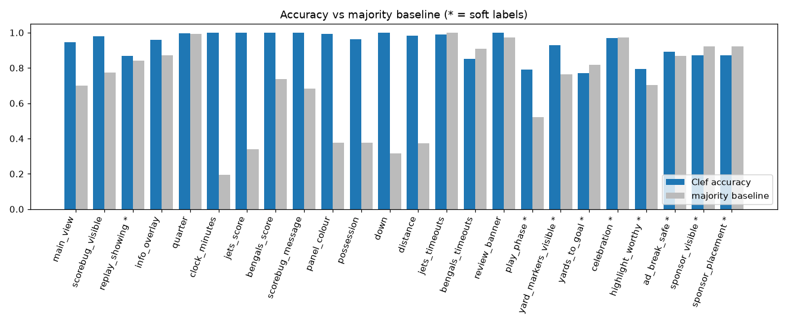
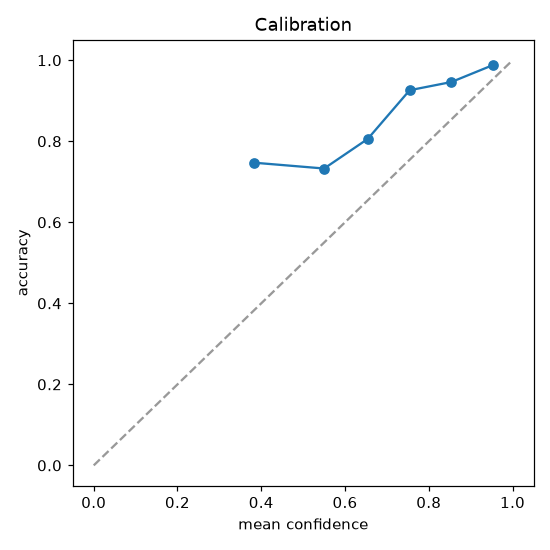

# Accuracy report: run_001

Model `cloudflare/clef`, schema v2b, 408 frames (the 4th quarter, one every 5 s), 8687 scored answers. Scorebug crop sent as a second image: yes.

**About the labels.**

- **Group B (scorebug):** read from every frame by Claude and checked against the official nflverse play-by-play; the two agree on all but 12 frames, where the label follows what the broadcast shows. The scorebug is hidden on 92 frames; group B is not scored there.
- **Groups A, C, D:** drafted by Claude from the frames; the maintainer spot-checked a sample and corrected what was found. They are **AI-drafted and only partly human-reviewed.**
- **Questions marked \*** are soft labels: one reader's judgement from a single still, known to contain errors (sponsor labels especially). Their numbers are indicative only and are left out of the headline.

## Headline

**98%** of answers correct on the 15 firm-label questions (5015 answers); **98%** on reading the scorebug.

## Summary

| Question | n | Accuracy | Majority baseline | Macro-F1 | Near-miss |
|---|---|---|---|---|---|
| main_view | 408 | 95% | 70% | 0.86 |  |
| scorebug_visible | 408 | 98% | 77% | 0.97 |  |
| replay_showing * | 408 | 87% | 84% | 0.62 |  |
| info_overlay | 408 | 96% | 87% | 0.87 |  |
| quarter | 316 | 100% | 99% | 0.83 |  |
| clock_minutes | 316 | 100% | 19% | 1.00 | 0% |
| jets_score | 316 | 100% | 34% | 1.00 | 0% |
| bengals_score | 316 | 100% | 74% | 1.00 | 0% |
| scorebug_message | 316 | 100% | 68% | 1.00 |  |
| panel_colour | 316 | 99% | 38% | 1.00 |  |
| possession | 316 | 96% | 38% | 0.96 |  |
| down | 316 | 100% | 32% | 1.00 |  |
| distance | 316 | 98% | 37% | 0.97 | 0% |
| jets_timeouts | 316 | 99% | 100% | 1.00 | 1% |
| bengals_timeouts | 315 | 85% | 91% | 0.79 | 4% |
| review_banner | 316 | 100% | 97% | 1.00 |  |
| play_phase * | 408 | 79% | 52% | 0.48 |  |
| yard_markers_visible * | 408 | 93% | 76% | 0.91 |  |
| yards_to_goal * | 408 | 77% | 82% | 0.32 | 9% |
| celebration * | 408 | 97% | 97% | 0.78 |  |
| highlight_worthy * | 408 | 79% | 70% | 0.73 |  |
| ad_break_safe * | 408 | 89% | 87% | 0.77 |  |
| sponsor_visible * | 408 | 87% | 92% | 0.74 |  |
| sponsor_placement * | 408 | 87% | 92% | 0.79 |  |

The majority baseline is the accuracy of always giving that question's most common label. A question only "works" if Clef clearly beats it. Near-miss is the share of answers exactly one option away.

## By group

| Group | Accuracy, all questions | Accuracy, firm labels only |
|---|---|---|
| A. Layout | 94% | 96% |
| B. Scorebug | 98% | 98% |
| C. Scene | 87% | no firm questions |
| D. Editorial | 86% | no firm questions |

## Scores

| Question | Frames with a score | Exact | Within 1 point | Answered not_visible |
|---|---|---|---|---|
| jets_score | 315 | 315 (100%) | 315 (100%) | 0 |
| bengals_score | 316 | 316 (100%) | 316 (100%) | 0 |

## Timeouts and celebration by team

| Question | n | Accuracy | Majority baseline |
|---|---|---|---|
| jets_timeouts | 316 | 99% | 100% |
| bengals_timeouts | 315 | 85% | 91% |

Celebration \*, by true label:

| True label | Frames | Found | Answered instead |
|---|---|---|---|
| jets | 11 | 6 | none 5 |
| bengals | 0 | 0 | none |
| none | 397 | 389 | bengals 4, jets 4 |

## Scorebug reading by kind of shot

Pooled accuracy on the group B questions, split by the labelled `main_view` of the frame.

| main_view | Frames | Answers | Scorebug accuracy |
|---|---|---|---|
| game_action | 211 | 2532 | 98% |
| coach_closeup | 56 | 671 | 98% |
| sideline_or_bench | 34 | 408 | 98% |
| crowd | 11 | 132 | 94% |
| other | 4 | 48 | 98% |

Split by `replay_showing` \* (almost every replay hides the scorebug, so the `yes` row is small):

| replay_showing | Frames | Answers | Scorebug accuracy |
|---|---|---|---|
| no | 316 | 3791 | 98% |

## Confusion matrix: main_view

Rows = label, columns = Clef.

| label \ Clef | game_action | sideline_or_bench | crowd | coach_closeup | booth_or_studio | full_screen_graphic | other |
|---|---|---|---|---|---|---|---|
| game_action | 281 | 3 |  |  |  |  | 1 |
| sideline_or_bench | 5 | 29 |  | 2 |  |  |  |
| crowd |  |  | 11 |  |  |  |  |
| coach_closeup | 1 |  |  | 54 |  |  | 7 |
| booth_or_studio |  |  |  |  | 4 |  |  |
| full_screen_graphic | 1 |  |  |  |  | 4 |  |
| other | 1 |  |  | 1 |  |  | 3 |

## Confusion matrix: play_phase *

Rows = label, columns = Clef.

| label \ Clef | pre_snap_lined_up | play_in_progress | kickoff | punt | field_goal | extra_point_or_two_point_try | kneel_down | not_a_play_shot |
|---|---|---|---|---|---|---|---|---|
| pre_snap_lined_up | 49 | 7 |  |  |  |  |  |  |
| play_in_progress | 4 | 93 |  | 4 | 1 | 2 |  | 3 |
| kickoff | 3 | 5 |  | 1 | 6 |  |  |  |
| punt |  | 2 |  | 1 |  |  |  |  |
| field_goal |  |  |  |  |  |  |  |  |
| extra_point_or_two_point_try | 4 |  |  |  | 2 | 8 |  |  |
| kneel_down |  | 1 |  |  |  |  |  |  |
| not_a_play_shot | 1 | 39 |  |  |  |  |  | 172 |

## Confusion matrix: possession

Rows = label, columns = Clef.

| label \ Clef | jets | bengals | not_shown |
|---|---|---|---|
| jets | 107 | 11 | 1 |
| bengals |  | 107 |  |
| not_shown |  |  | 90 |

## Calibration

All questions pooled.

| Confidence bin | n | Mean confidence | Accuracy |
|---|---|---|---|
| 0.0-0.5 | 846 | 0.38 | 75% |
| 0.5-0.6 | 434 | 0.55 | 73% |
| 0.6-0.7 | 479 | 0.65 | 81% |
| 0.7-0.8 | 1013 | 0.75 | 93% |
| 0.8-0.9 | 1244 | 0.85 | 95% |
| 0.9-1.0 | 4671 | 0.95 | 99% |

## 10 worst frames

| Frame | Wrong answers | Which |
|---|---|---|
| data/frames/f_0403.png | 5 | main_view (label sideline_or_bench, Clef coach_closeup); bengals_timeouts (label 2, Clef 1); celebration * (label jets, Clef none); highlight_worthy * (label yes, Clef no); ad_break_safe * (label yes, Clef no) |
| data/frames/f_0179.png | 5 | panel_colour (label green, Clef black); possession (label jets, Clef bengals); play_phase * (label play_in_progress, Clef extra_point_or_two_point_try); sponsor_visible * (label no, Clef yes); sponsor_placement * (label none, Clef field_or_stadium_boards) |
| data/frames/f_0195.png | 4 | main_view (label coach_closeup, Clef other); bengals_timeouts (label 3, Clef 0); sponsor_visible * (label no, Clef yes); sponsor_placement * (label none, Clef uniform_or_equipment) |
| data/frames/f_0196.png | 4 | main_view (label coach_closeup, Clef other); bengals_timeouts (label 3, Clef 0); sponsor_visible * (label no, Clef yes); sponsor_placement * (label none, Clef uniform_or_equipment) |
| data/frames/f_0202.png | 4 | main_view (label other, Clef coach_closeup); bengals_timeouts (label 3, Clef 0); sponsor_visible * (label no, Clef yes); sponsor_placement * (label none, Clef uniform_or_equipment) |
| data/frames/f_0263.png | 4 | main_view (label game_action, Clef sideline_or_bench); replay_showing * (label yes, Clef no); play_phase * (label play_in_progress, Clef not_a_play_shot); highlight_worthy * (label yes, Clef no) |
| data/frames/f_0375.png | 4 | main_view (label sideline_or_bench, Clef coach_closeup); ad_break_safe * (label yes, Clef no); sponsor_visible * (label no, Clef yes); sponsor_placement * (label none, Clef uniform_or_equipment) |
| data/frames/f_0132.png | 4 | scorebug_visible (label no, Clef yes); ad_break_safe * (label no, Clef yes); sponsor_visible * (label no, Clef yes); sponsor_placement * (label none, Clef uniform_or_equipment) |
| data/frames/f_0182.png | 4 | replay_showing * (label yes, Clef no); yard_markers_visible * (label no, Clef yes); yards_to_goal * (label cant_tell, Clef 20-49); highlight_worthy * (label yes, Clef no) |
| data/frames/f_0261.png | 4 | replay_showing * (label yes, Clef no); yard_markers_visible * (label no, Clef yes); yards_to_goal * (label cant_tell, Clef 20-49); highlight_worthy * (label yes, Clef no) |

## Cost and latency

- Input tokens, all frames: 2,825,370
- Cost, all frames: $0.6781 ($0.00166 per frame; $1.20 per broadcast hour at one frame every 5 s)
- Latency: median 2.3435 s, p95 2.946 s

Play-by-play: nflverse (https://github.com/nflverse).

## Event detection

Settings: `min_conf` 0.6, `persist_frames` 2, hit window -5 s to +20 s. **14 of 17 true events hit, 3 missed, 0 false positives.** Median delay on hits +0 s.

True events are timed at the first frame where the scorebug shows them.

| True event | Game clock | True time | Detected | Outcome | Delay (s) |
|---|---|---|---|---|---|
| penalty | 15:00 | 5101 s (1:25:00) | 5101 s | hit | +0 |
| touchdown_jets | 14:21 | 5201 s (1:26:41) | 5201 s | hit | +0 |
| two_point_good | 14:17 | 5246 s (1:27:26) | 5246 s | hit | +0 |
| touchdown_bengals | 10:24 | 5600 s (1:33:20) | 5600 s | hit | +0 |
| replay_review (upheld) | 10:24 | 5620 s (1:33:40) | none | miss |  |
| extra_point_good | 10:21 | 5640 s (1:34:00) | 5640 s | hit | +0 |
| touchdown_jets | 08:01 | 5935 s (1:38:55) | 5935 s | hit | +0 |
| replay_review (reversed) | 07:52 | 6030 s (1:40:30) | 6030 s | hit | +0 |
| two_point_good | 07:52 | 6125 s (1:42:05) | 6125 s | hit | +0 |
| possession_change (punt) | 07:04 | 6345 s (1:45:45) | 6350 s | hit | +5 |
| touchdown_jets | 02:00 | 6700 s (1:51:40) | 6700 s | hit | +0 |
| tie | 02:00 | 6700 s (1:51:40) | 6700 s | hit | +0 |
| extra_point_good | 01:54 | 6735 s (1:52:15) | 6735 s | hit | +0 |
| lead_change | 01:54 | 6735 s (1:52:15) | 6735 s | hit | +0 |
| timeout_bengals | 00:37 | 6960 s (1:56:00) | none | miss |  |
| possession_change (turnover_on_downs) | 00:32 | 7060 s (1:57:40) | 7060 s | hit | +0 |
| game_end | 00:27 | 7100 s (1:58:20) | none | miss |  |

### False positives

None.

Not scored: `first_down` fired 7 times and `two_point_attempt` at 5221 s, 5970 s.

### Sensitivity

Each cell is hits / misses / false positives.

| min_conf \ persist_frames | 1 | 2 | 3 |
|---|---|---|---|
| 0.5 | 13 / 4 / 6 | 12 / 5 / 4 | 11 / 6 / 5 |
| 0.6 | 15 / 2 / 0 | 14 / 3 / 0 | 14 / 3 / 0 |
| 0.7 | 15 / 2 / 0 | 14 / 3 / 0 | 14 / 3 / 0 |

Most hits with fewest false positives: `min_conf` 0.6, `persist_frames` 1 (15 hits, 0 false positives).
